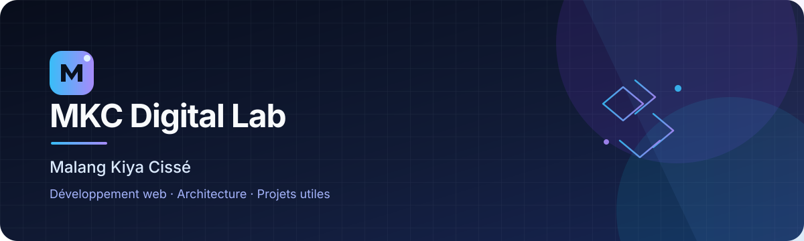

### Développeur web · Construire, comprendre, faire évoluer

**PHP · Laravel · JavaScript · Vue.js · SQL · Docker · Git · CI/CD**

[Portfolio](https://malang-kiya-cisse-portfolio.onrender.com) · [GitHub](https://github.com/mkcdigitallab) · [GitLab](https://gitlab.com/mkcdigitallab)

---

## À propos

Je suis **Malang Kiya Cissé**, développeur web basé au Sénégal. Je construis des applications et je travaille à les rendre compréhensibles, fiables et capables d'évoluer.

Mon approche : comprendre le besoin, réfléchir à la solution, organiser le code, tester, documenter et améliorer.

- **Développement :** PHP, Laravel, JavaScript, Vue.js et conception d'API.
- **Données :** SQL, PostgreSQL, MySQL et modélisation relationnelle.
- **Outils :** Git, GitHub, GitLab, Docker et Linux.
- **Qualité :** tests, intégration continue, documentation et architecture.

Je distingue les technologies que je pratique dans mes projets de celles que je suis encore en train d'explorer.

## Projets mis en avant

### [Fondé 44](https://github.com/mkcdigitallab/fonde-44)
Une solution numérique autour d'une activité familiale de production et de vente de fondé et de thiakry. L'objectif est de simplifier la présentation des produits, les commandes et la gestion quotidienne.

**Enjeux :** expérience mobile, simplicité d'utilisation, gestion des produits et évolution progressive.

### [Reservation-Salles](https://github.com/mkcdigitallab/Reservation-Salles)
Application de réservation de salles développée avec Laravel. Ce projet me permet de travailler sur les règles métier, la validation, les données, les tests et la qualité du code.

**Stack principale :** PHP · Laravel · SQL · Docker · GitLab CI/CD.

### [Mon portfolio](https://malang-kiya-cisse-portfolio.onrender.com)
Mon espace professionnel pour présenter mon profil, mes compétences et les projets sur lesquels je travaille.

### [Formation complète Vue.js](https://github.com/mkcdigitallab/formation-complete-vuejs)
Un dépôt d'apprentissage structuré pour comprendre Vue.js progressivement, avec les notions expliquées et mises en pratique.

---

## Ma manière de travailler

1. **Comprendre** le problème et les règles métier.
2. **Concevoir** les responsabilités et les données avant de coder.
3. **Développer** par petites étapes avec Git.
4. **Vérifier** avec des tests et des contrôles adaptés.
5. **Documenter** les décisions et les points importants.
6. **Améliorer** sans rendre le projet plus compliqué que nécessaire.

Je privilégie la compréhension et l'autonomie plutôt que la simple reproduction de code.

## Technologies & outils

  
  
  
  
  
  
  
  
  

## Me retrouver

- 🌐 **Portfolio :** [malang-kiya-cisse-portfolio.onrender.com](https://malang-kiya-cisse-portfolio.onrender.com)
- 💻 **GitHub :** [@mkcdigitallab](https://github.com/mkcdigitallab)
- 🦊 **GitLab :** [mkcdigitallab](https://gitlab.com/mkcdigitallab)

---

**BUILD · LEARN · EVOLVE**

*Construire aujourd'hui des compétences pour créer demain des solutions utiles.*

