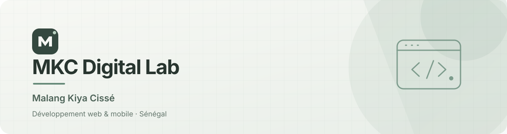

### Développeur web & mobile

Je conçois des applications utiles, de l’interface à la logique métier.

**PHP · Laravel · JavaScript · TypeScript · Vue.js · Node.js · SQL**

[Portfolio](https://malang-kiya-cisse-portfolio.onrender.com) · [GitLab](https://gitlab.com/mkcdigitallab) · [Me contacter](mailto:papac8443@gmail.com)

---

## Bonjour, moi c’est Malang 👋

Développeur web basé au Sénégal, je m’intéresse à la conception et à la réalisation d’applications complètes : comprendre le besoin, structurer les données, construire l’interface, développer les fonctionnalités et vérifier que tout fonctionne.

J’aime particulièrement les projets qui répondent à un problème concret et qui peuvent être utilisés dans la vie réelle.

## Projets sélectionnés

| Projet | Description | Technologies |
|---|---|---|
| [Signalement Urbain](https://github.com/mkcdigitallab/Signalement-Urbain) | Une plateforme pour signaler et suivre des problèmes dans l’espace urbain. | Laravel · PHP · JavaScript |
| [FlexPay Sénégal](https://github.com/mkcdigitallab/FlexPaySenegal) | Application de portefeuille numérique avec gestion des utilisateurs et des transactions. | Laravel · Inertia · Vue.js |
| [Réservation-Salles](https://github.com/mkcdigitallab/Reservation-Salles) | Gestion des salles, réservations et règles de disponibilité. | Laravel · PHP · PostgreSQL · Docker |
| [Fondé 44](https://github.com/mkcdigitallab/fonde-44) | Outil mobile de présentation des produits, commandes et gestion d’une activité familiale. | Application web · PWA · Vue.js |

## Environnement technique

**Développement**  
PHP · Laravel · JavaScript · TypeScript · Vue.js · Node.js · Express

**Données**  
PostgreSQL · MySQL · MariaDB · SQLite

**Outils & qualité**  
Git · GitHub · GitLab · Docker · Linux · Nginx · Tests · CI/CD

*Cette liste rassemble les technologies utilisées dans mes projets et celles que j’approfondis actuellement.*

## Ma façon de travailler

- Comprendre le besoin et les règles métier avant de coder.
- Avancer par étapes et garder un projet bien organisé.
- Comprendre les outils, les dépendances et le code que j’utilise.
- Tester, documenter et améliorer progressivement.

---

**Construire · Apprendre · Faire évoluer**

🌍 Sénégal

